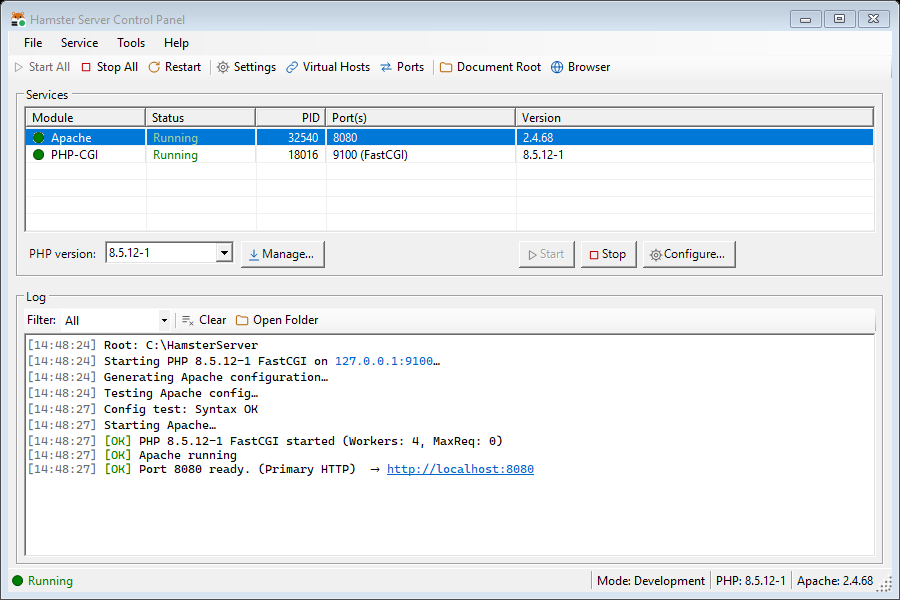
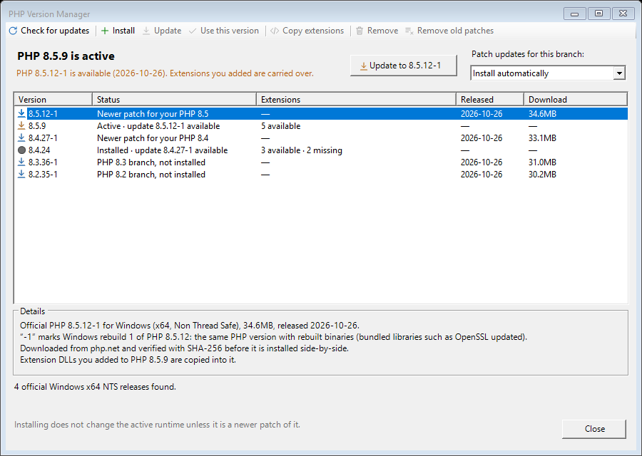
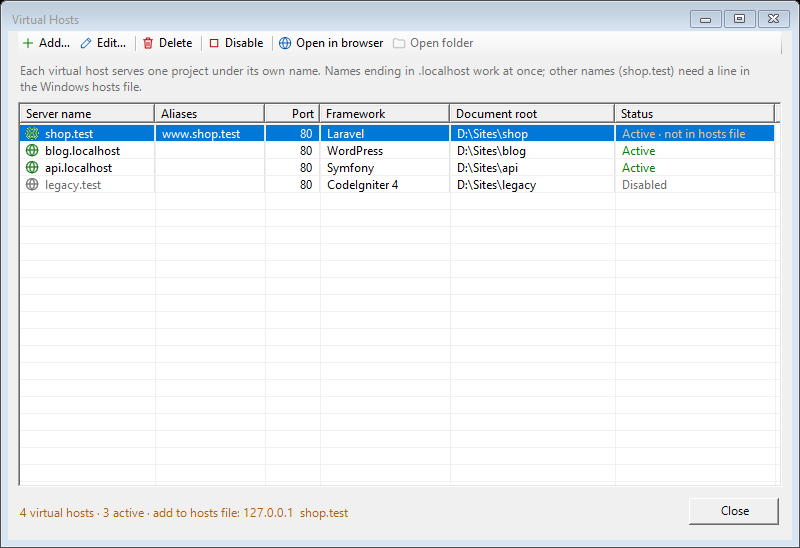
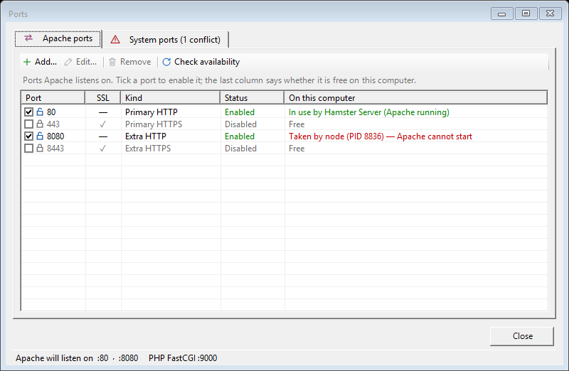
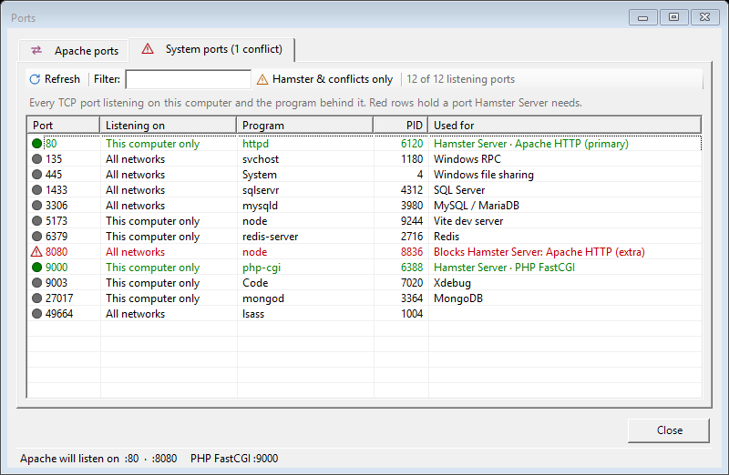
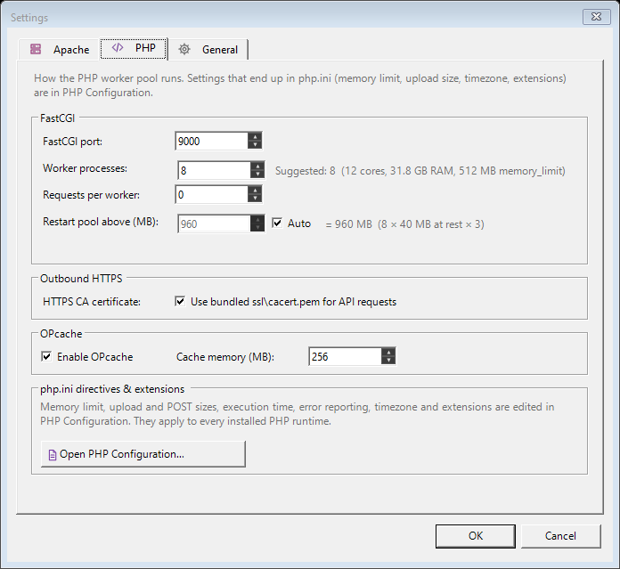

<h1>
  <picture>
    <source media="(prefers-color-scheme: dark)" srcset="icon/svg/hamster-server-c01-horizontal-reverse.svg">
    
  </picture>
</h1>

[](https://github.com/cmm-cmm/Hamster-Server/releases/latest)
[](LICENSE)


**A portable Apache + PHP development server for Windows, with a control panel that does the
configuration for you.**

Unzip it, press **Start All**, and your PHP projects run at `http://localhost/` or under names
like `shop.test`. You don't edit `httpd.conf` or `php.ini` by hand or install services, and PHP
keeps itself on the latest patch.



**Website:** [hamsterserver.konexforge.com](https://hamsterserver.konexforge.com/)

Hamster Server is a product of [Konex Forge](https://konexforge.com/). Current version: **1.4.1**.

---

## Contents

- [Why Hamster Server](#why-hamster-server)
- [Download and install](#download-and-install)
- [Your first site](#your-first-site)
- [Using Hamster Server](#using-hamster-server)
  - [Starting and stopping](#starting-and-stopping)
  - [PHP versions and automatic updates](#php-versions-and-automatic-updates)
  - [PHP settings and extensions](#php-settings-and-extensions)
  - [Websites (virtual hosts)](#websites-virtual-hosts)
  - [Ports](#ports)
  - [Settings](#settings)
- [Troubleshooting](#troubleshooting)
- [Upgrading Hamster Server](#upgrading-hamster-server)
- [What's included](#whats-included)
- [Security and privacy](#security-and-privacy)
- [For developers](#for-developers)
- [Contributing, license and support](#contributing-license-and-support)

---

## Why Hamster Server

- **Nothing to configure by hand.** Apache's configuration, every site's configuration and every
  PHP runtime's `php.ini` are generated from what you choose in the app.
- **Several PHP versions side by side.** PHP 8.2, 8.3, 8.4 and 8.5 are included; switch with
  one click, or install any other official release from php.net.
- **PHP updates itself.** New patches of the PHP branch you use are installed next to the current
  one and activated while no request is running. Extensions you added, such as SQL Server
  drivers or Xdebug, are moved over for you.
- **Ready for real frameworks.** Site presets for Laravel, Symfony, WordPress, Drupal, Magento,
  CodeIgniter, Yii, CakePHP, Phalcon, Slim and Hyperf.
- **Clear answers when something is wrong.** Hamster Server shows which program is holding the
  port Apache needs, and tells you when a site's name is missing from the hosts file.
- **Portable and private.** Everything lives in one folder. Apache listens on this computer only
  unless you allow your network, and php.net is the only site Hamster Server contacts.

## Download and install

**Requirements:** Windows 10 or 11 (x64) and the
[.NET 10 Desktop Runtime (x64)](https://dotnet.microsoft.com/download/dotnet/10.0).

1. Download **`HamsterServer-<version>-win-x64.zip`** from the
   [latest release](https://github.com/cmm-cmm/Hamster-Server/releases/latest).
2. *(Optional)* Check the download against the `.sha256` file published with it:
   ```powershell
   Get-FileHash .\HamsterServer-1.4.1-win-x64.zip -Algorithm SHA256
   ```
3. Extract it to a folder you can write to, for example `D:\HamsterServer`. Avoid
   `C:\Program Files`: Hamster Server writes its settings and logs next to itself.
4. Run **`HamsterServer.exe`**.

There is no installer and nothing is registered system-wide. To remove Hamster Server, close it
and delete the folder. If you turned on **Launch with Windows**, turn it off first.

## Your first site

1. Press **Start All**. The Apache and PHP-CGI rows turn green.
2. Open `http://localhost/`. You will see the built-in dashboard served from the `www` folder.
3. To serve your own project, open **Tools › Virtual Hosts › Add…**, choose the project folder
   and a framework preset, and give the site a name:
   - a name ending in **`.localhost`** (for example `shop.localhost`) works straight away;
   - any other name (for example `shop.test`) needs one line in the Windows hosts file.
     Hamster Server shows you exactly which line (see [Websites](#websites-virtual-hosts)).
4. Hamster Server restarts Apache for you. Open the site from the **Open in browser** button.

## Using Hamster Server

### Starting and stopping

- **Start All / Stop All / Restart** on the toolbar control Apache and PHP together. The
  **Service** menu, the buttons beside the Services list and its right-click menu control each
  one separately.
- If PHP crashes, it is restarted automatically. If its memory grows past a safe limit, the
  worker pool is refreshed at a moment when nothing is being served, so no request is cut off.
- The log pane shows Apache, PHP and Hamster Server messages in colour, with filters. The same
  messages are written to daily files in `config\logs\server`.
- Closing the window keeps Hamster Server in the system tray (this can be changed in Settings).
  The tray icon shows whether everything is running.

### PHP versions and automatic updates

Pick the active PHP version from the main window. Open **Tools › PHP Version Manager** (or
**Manage…**) to see everything at a glance: which version is active, whether it is up to date,
and which versions you can install.



**Automatic updates.** Choose one of three modes at the top right of the PHP Version Manager:

| Mode | What happens |
|---|---|
| **Install automatically** *(default)* | When php.net publishes a newer patch of the branch you use (for example 8.5.9 → 8.5.12-1), Hamster Server downloads it, installs it next to the current version, carries your extensions over and switches to it at a moment when PHP is idle. |
| **Notify me only** | The status bar and the tray tell you an update is available; you install it with one click. |
| **Off** | Hamster Server never contacts php.net on its own. |

Hamster Server checks a minute after it starts and every six hours. Good to know:

- Updates stay within your branch (8.5.x stays 8.5.x). Moving to a new branch, such as 8.4 → 8.5,
  is always your decision, because extensions built for one branch do not load in another.
- The previous version is kept, so you can switch back. **Remove old patches** deletes the old
  versions when you no longer need them.
- **Extensions you added come along.** Extension files you placed in a version's `ext` folder
  (for example Microsoft's `php_sqlsrv.dll`) are copied into the new patch automatically.
- For every installed version, the window shows extensions that are switched on but missing. If
  another version of the same branch has them, **Copy extensions** brings them over.
- Downloads come only from php.net over HTTPS. Each one is checked against php.net's SHA-256
  checksum before it is installed.

### PHP settings and extensions

Open **Tools › PHP Configuration**, or right-click the PHP-CGI row and choose **Configure PHP…**:

- **Settings tab:** memory limit, maximum upload and POST size, execution time, error reporting,
  short open tags and time zone.
- **Extensions tab:** tick the extensions you need. **Recommended** selects a profile that works
  in every included PHP version (curl, gd, intl, mbstring, mysqli, openssl, pdo_mysql, zip…).
  The selection applies to every installed PHP version.
- **php.ini tab:** a read-only view of the file Hamster Server generated.

**Save & restart PHP** applies the change immediately. PHP errors are written to
`config\logs\php_error.log` instead of the page, because printing them would break responses
in this server setup.

### Websites (virtual hosts)



**Tools › Virtual Hosts** lists your sites. For each one you can:

- **Add / Edit:** set the name, extra names (aliases), the port, the project folder and a
  framework preset. The preset picks the public folder (for example Laravel's `public`), routes
  requests through the framework's front controller and blocks access to files such as `.env`.
- **Enable / Disable** a site without deleting it.
- **Open in browser** or **Open folder**.

**"Active · not in hosts file"** means Apache serves the site, but Windows doesn't yet know the
name belongs to this computer. Add the line shown at the bottom of the window to
`C:\Windows\System32\drivers\etc\hosts` (open Notepad as administrator), for example:

```
127.0.0.1  shop.test
```

Names ending in `.localhost` never need this step.

### Ports

**Tools › Ports** has two tabs.

**Apache ports** lists the ports Apache listens on: the main HTTP port, HTTPS if enabled, and any
extra ports. Tick or untick a port to switch it on or off. The **On this computer** column tells
you, before you start, whether each port is free, already used by Hamster Server, or taken by
another program.



**System ports** lists every port that is open on your computer and the program behind it:

- **green** rows belong to Hamster Server;
- **red** rows are programs holding a port Hamster Server needs, which would stop Apache or PHP
  from starting;
- common development services (MySQL, SQL Server, Redis, MongoDB, Vite, Xdebug…) are labelled.

Filter by port or program, press **F5** to refresh, and right-click a row to open it in the
browser, open the program's folder or copy its details.



### Settings

**Tools › Settings** has three tabs:

- **Apache:** server name, connection limits, Gzip/Brotli compression, browser caching for
  images, CSS and scripts, and HTTPS with your own certificate.
- **PHP:** the FastCGI port, the number of PHP worker processes (with a suggestion based on
  your CPU and memory), automatic memory-based restarts, OPcache, and the certificate store used
  when your PHP code calls HTTPS APIs.
- **General:** development or production mode, tray behaviour, starting the services when
  Hamster Server opens, launching with Windows, and access from other computers on your network.



Anything that ends up in `php.ini` is edited in **PHP Configuration**, not here.

## Troubleshooting

| Problem | What to do |
|---|---|
| **"Port already in use"**, Apache will not start | Open **Ports › System ports**. The red row shows which program holds the port. Close that program, or give Apache another port under **Apache ports**. Skype, IIS, other local servers (XAMPP, Laragon) and Docker often use port 80. |
| **The site does not open in the browser** | In **Virtual Hosts**, look for "not in hosts file" and add the line shown at the bottom of the window. Or rename the site to something ending in `.localhost`. |
| **An extension stopped working after a version change** | The **PHP Version Manager** lists missing extensions for each version. Within the same branch, **Copy extensions** fixes it. For a different branch, download the extension built for that PHP version (Non Thread Safe, x64) into its `ext` folder. |
| **PHP did not update** | The log pane explains why, in lines marked `[PHP]`. The **Check for updates** button retries. Updates need internet access to php.net. |
| **A page shows a blank screen or error 500** | Read `config\logs\php_error.log` (errors are not printed on the page). |
| **Custom Apache directives were rejected** | Hamster Server tests them before saving; the message shows Apache's own explanation. Nothing is changed until they are valid. |

## Upgrading Hamster Server

1. Close Hamster Server (right-click the tray icon › **Exit**).
2. Extract the new version to a **new** folder.
3. Copy these from the old folder into the new one:
   - `config\hamster-server.json`: your settings and sites;
   - any PHP version folders you installed yourself under `php\`;
   - your projects, if you kept them in `www\`.
4. Start the new `HamsterServer.exe`.

## What's included

| Component | Version |
|---|---|
| Apache HTTP Server | 2.4.68 (VS18, Win64) |
| PHP | 8.2.35-1, 8.3.36-1, 8.4.27-1, 8.5.12-1 (Non Thread Safe, x64) — patched against PHP2Shell (CVE-2026-109618, CVE-2026-109619) |
| CA certificate bundle | Mozilla roots, extracted 2026-08-13 |

With automatic updates on, your active PHP branch moves to its newest patch after the first
start. Download sources and checksums of the included builds are listed in
[THIRD_PARTY_RUNTIMES.md](THIRD_PARTY_RUNTIMES.md).

## Security and privacy

- **Local only by default.** Apache accepts connections from this computer only. Allowing other
  computers is a separate, explicit switch under **Settings › General**; use it on trusted
  networks only.
- **One outside connection.** Hamster Server contacts only `windows.php.net` and
  `downloads.php.net`, over HTTPS, to check for and download PHP. Set updates to **Off** to stop
  even that. Downloads are installed only when their SHA-256 checksum matches php.net's.
- **Read-only access to the hosts file.** Hamster Server reads the Windows hosts file to warn you
  about missing entries, but never changes it.
- **No administrator rights needed**, as long as the folder is writable.

Report security issues privately as described in [SECURITY.md](SECURITY.md).

## For developers

### Build from source

Requires Windows x64, [Git LFS](https://git-lfs.com/) (the Apache and PHP binaries are stored
with it) and the .NET 10 SDK `10.0.400` or a compatible patch release.

```powershell
git lfs install
git clone https://github.com/cmm-cmm/Hamster-Server.git
cd Hamster-Server
dotnet build HamsterServer.slnx
dotnet run --project HamsterServer/HamsterServer.csproj
```

### Test, check and publish

```powershell
dotnet test HamsterServer.slnx
dotnet format HamsterServer.slnx --verify-no-changes
dotnet publish HamsterServer/HamsterServer.csproj -c Release
```

Some tests reach outside the test process and only run when you ask for them:

| Variable | Runs |
|---|---|
| `HAMSTER_SOAK=1` with `--filter "TestCategory=Soak"` | Load tests against the real Apache/PHP stack. They bind ports and stop every Apache/PHP process of the build, so close Hamster Server first. |
| `HAMSTER_LIVE_PHPNET=1` | Reads the live php.net release list. |
| `HAMSTER_LIVE_INSTALL=1` (with the above) | Also downloads, installs and runs the newest PHP release in a temporary folder. |
| `HAMSTER_FORM_SNAPSHOT_DIR=<folder>` | Renders the configuration windows to PNG files. |
| `HAMSTER_README_SCREENSHOTS=<folder>` | Renders the screenshots in `site/images` (README and website) from sample data. |
| `HAMSTER_GLYPH_SHEET=<file>.png` | Renders the whole icon set to one image. |

### Project layout

| Path | Contents |
|---|---|
| `HamsterServer/Core/` | Service lifecycle, configuration generation, PHP updates, port scanning, logging |
| `HamsterServer/Models/` | Settings, ports, virtual hosts and framework presets |
| `HamsterServer/Forms/` | The secondary windows |
| `HamsterServer/apache/`, `HamsterServer/php/` | Included Apache and PHP builds (Git LFS) |
| `HamsterServer/config/` | Runtime configuration and generated files |
| `HamsterServer/www/` | Default site, also the performance dashboard |
| `ssl/` | CA bundle and OpenSSL files |
| `doc/` | Performance measurements and the icon and logo reference |
| `icon/` | The brand kit: the logo as SVG, PNG and ICO, favicons and usage rules |
| `site/` | The website at hamsterserver.konexforge.com; `site/images` also holds the README screenshots |
| `HamsterServer.Tests/` | Unit, runtime smoke, load and opt-in live tests |

[CLAUDE.md](CLAUDE.md) explains the architecture and the rules the code depends on;
[AGENTS.md](AGENTS.md) covers coding style and commit conventions;
[doc/ICONS_AND_LOGO.md](doc/ICONS_AND_LOGO.md) documents the icon set.

Settings are stored in `config\hamster-server.json`. Everything else under `config\` (Apache
configuration, site files, logs) and every runtime's `php.ini` is generated, so hand edits there
are replaced. Work happens on the `dev` branch and reaches `main` through pull requests.

## Contributing, license and support

Contributions are welcome. Please read [CONTRIBUTING.md](CONTRIBUTING.md) and the
[Code of Conduct](CODE_OF_CONDUCT.md) first, and include screenshots in pull requests that
change the interface.

Hamster Server's source code is released under the [MIT License](LICENSE). The included Apache,
PHP and related components keep their own licenses; see
[THIRD_PARTY_RUNTIMES.md](THIRD_PARTY_RUNTIMES.md).

If Hamster Server saves you time, you can support its development through
[GitHub Sponsors](https://github.com/sponsors/cmm-cmm).
